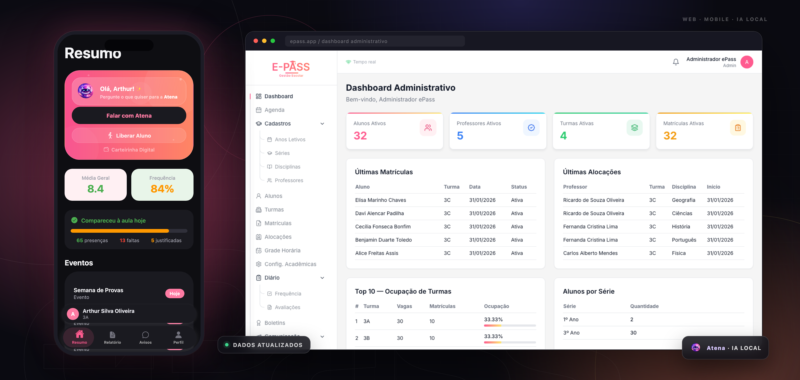
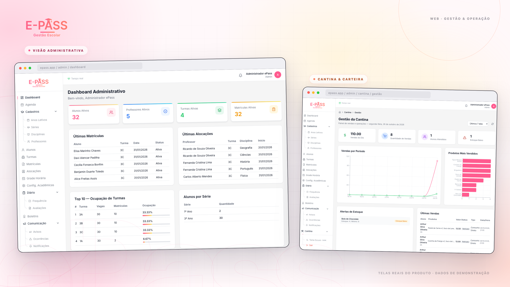
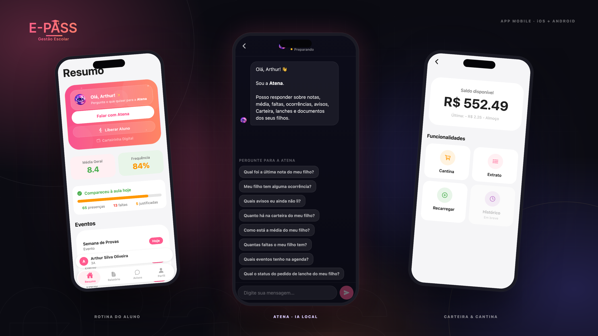
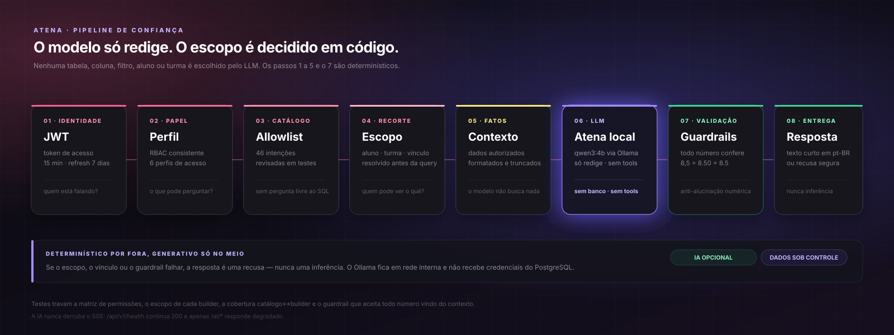
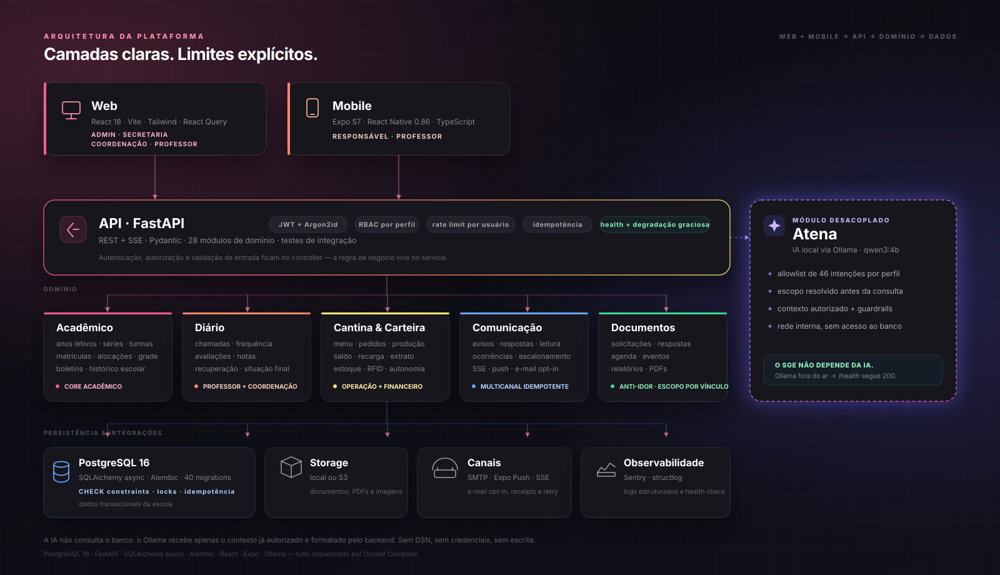

<div align="center">


<h1>A escola inteira, em um só lugar.</h1>

<p><strong>Do diário de classe ao lanche na cantina.</strong> O ePass conecta a operação acadêmica, a comunicação, a cantina e a carteira do aluno em uma única fonte de verdade.</p>

<p>Web para a gestão. Mobile para as famílias e professores. <strong>Atena</strong> para as respostas — com IA que roda dentro da escola.</p>

<p>
  <a href="https://www.python.org/"></a>
  <a href="https://fastapi.tiangolo.com/"></a>
  <a href="https://www.postgresql.org/"></a>
  <a href="https://react.dev/"></a>
  <a href="https://expo.dev/"></a>
  <a href="https://www.typescriptlang.org/"></a>
  <a href="https://docs.docker.com/compose/"></a>
  <a href="#atena"></a>
</p>

<p>
  <a href="#visão-geral"><strong>Visão geral</strong></a> ·
  <a href="#funcionalidades"><strong>Funcionalidades</strong></a> ·
  <a href="#produto-em-ação"><strong>Produto em ação</strong></a> ·
  <a href="#atena"><strong>Atena</strong></a> ·
  <a href="#arquitetura"><strong>Arquitetura</strong></a> ·
  <a href="#como-executar"><strong>Como executar</strong></a>
</p>



<p><sub>Dashboard web e app do responsável — telas reais capturadas do projeto em execução.</sub></p>

</div>


| **6** <br> perfis de acesso | **46** <br> intenções na Atena | **10** <br> casos de uso documentados | **100%** <br> IA local |
| :---: | :---: | :---: | :---: |
| do admin à cantina, cada pessoa vê o que precisa | allowlist por perfil com guardrails numéricos | fluxos técnicos com código por camada | Ollama na rede interna, sem sair da escola |

## Visão geral

O ePass é uma plataforma de gestão escolar de ponta a ponta. Ele foi desenhado para a rotina real de uma escola — não para um cenário idealizado: matrícula, turma, chamada, avaliação, boletim, aviso, ocorrência, lanche, carteira, documento e conversa com a família.

A operação de uma escola costuma viver em ilhas: o diário em um sistema, a matrícula em uma planilha, o lanche em um caderno, o aviso em um grupo de mensagens e o boletim no papel. O ePass junta essas pontas em uma base comum e entrega a cada perfil uma experiência adequada ao seu dia.

| Perfil | O que encontra no ePass |
| --- | --- |
| **Administração** | Visão completa da escola, configurações acadêmicas, cadastros, matrículas, financeiro, cantina, comunicação e Atena. |
| **Secretaria** | Alunos, turmas, matrículas, alocações, grade horária, documentos, boletins, comunicação e Atena. |
| **Coordenação** | Ocorrências, avisos, acompanhamento de leitura, visão pedagógica e Atena. |
| **Professor** | Turmas, chamadas, frequência, avaliações, notas, boletins, correção de gabarito e Atena com escopo por turma. |
| **Responsável** | App mobile com múltiplos filhos, notas, frequência, calendário, avisos, ocorrências, carteira, cantina, carteirinha digital e solicitação de documentos. |
| **Cantina** | Pedidos, produção, retirada, cardápio, estoque, alertas, consumo direto, autonomia do aluno e acompanhamento operacional. |

> **A proposta é simples:** cada pessoa enxerga a escola pelo seu ângulo, mas todas leem a mesma base. O que muda é o recorte de acesso — não a verdade sobre os dados.

### Um produto, dois canais

A **web** concentra a operação: administração, secretaria, coordenação, professores e cantina. O **app mobile** leva a rotina para o bolso de famílias e professores. Os dois consomem a mesma API FastAPI, com as mesmas regras de negócio e o mesmo controle de permissões.

## Funcionalidades

O recorte abaixo é do que está **implementado no código** — não de um roadmap.

### Núcleo acadêmico

- **Ciclo escolar completo** — anos letivos, séries, disciplinas, professores, turmas, alocações, matrículas e grade horária.
- **Diário de classe** — chamadas, frequência com presença, falta e falta justificada, avaliações, notas e recuperação.
- **Boletim com regra de negócio** — média ponderada por disciplina, frequência mínima, recuperação, situação final e janela de liberação para o responsável.
- **Histórico e documentos** — histórico escolar do aluno e solicitação de documentos com status, resposta da secretaria e bloqueio de acesso cruzado.
- **Agenda e comunicação institucional** — eventos segmentados por professor, responsável ou turma, avisos com respostas, leitura e escalonamento de não lidos.

### Cantina, carteira e operação

- **Pedido de ponta a ponta** — cardápio, pedido, aprovação com débito idempotente, produção, pronto, retirada e cancelamento, com Kanban operacional.
- **Carteira do aluno** — saldo, extrato, recarga, débito e estorno, com visão do responsável.
- **Idempotência onde importa** — `idempotency_key`, lock pessimista na carteira e índice único parcial: retry de terminal ou duplo clique não cobra duas vezes.
- **Pulseira RFID** — o consumo no balcão resolve a pulseira até o aluno, debita a carteira e registra a movimentação.
- **Estoque e autonomia** — entrada e saída de estoque, alertas de mínimo, consumo direto e permissão para o aluno escolher o próprio lanche.
- **Programação semanal** — o responsável monta a semana; um job converte a programação em pedido e a cantina acompanha a produção.

### Família e acompanhamento

- **App do responsável** — média geral, frequência, eventos, carteira e troca entre filhos sem trocar de conta.
- **Cantina no mobile** — programação semanal, pedido do dia, acompanhamento de status, autonomia e histórico.
- **Carteirinha digital** — cartão com identificação do aluno e QR Code gerado no dispositivo.
- **Solicitação de documentos** — boletim, histórico, declaração de matrícula e comprovantes, com acompanhamento de status.
- **Atena no app** — respostas em linguagem natural sobre a vida escolar do filho, dentro do escopo do responsável.

### Professor

- **Rotina de sala** — turmas, chamadas, frequência, avaliações, notas e boletins.
- **Correção de gabarito por câmera** — OMR local: o professor fotografa a folha, o app detecta os quatro marcadores, corrige a perspectiva, lê as bolhas e compara com o gabarito.
- **Revisão humana antes do lançamento** — o resultado é apresentado para conferência; as notas só são lançadas em lote depois da confirmação.
- **Privacidade por padrão** — nenhuma imagem da folha do aluno sai do dispositivo.

### Comunicação, acessibilidade e segurança

- **Tempo real** — SSE para notificações in-app, push via Expo e e-mail com opt-in por tipo de evento.
- **Sem duplicidade** — o despachante usa `evento_key` com `ON CONFLICT DO NOTHING`; o mesmo aviso não vira cinco notificações.
- **Acessibilidade** — tema claro e escuro, alto contraste, quatro escalas de texto e manutenção da tela ligada.
- **Segurança** — JWT de acesso curto, refresh token, Argon2id, RBAC por perfil, rate limit por usuário na Atena e CORS explícito.
- **Observabilidade** — health check, logs estruturados com structlog e Sentry opcional.

## Produto em ação

As telas abaixo são reais, capturadas do projeto em execução com dados de demonstração. Clique em uma composição para abrir a captura em tamanho real.

[](docs/assets/screens/web-admin-dashboard-light-1100.png)

**Web · gestão e operação.** Dashboard com alunos, professores, turmas, ocupação, matrículas e alocações — ao lado do painel da cantina com vendas do dia, produtos mais vendidos, alertas de estoque e últimas vendas.

[Abrir dashboard em tamanho real](docs/assets/screens/web-admin-dashboard-light-1100.png) · [Abrir painel da cantina](docs/assets/screens/web-cantina-light.png)

[](docs/assets/screens/mobile-home-light.png)

**Mobile · a rotina da família.** Média e frequência em destaque, eventos do dia, acesso à Atena, saldo da carteira e a possibilidade de alternar entre filhos sem trocar de conta.

[Abrir rotina do aluno](docs/assets/screens/mobile-home-light.png) · [Abrir Atena](docs/assets/screens/mobile-atena.png) · [Abrir carteira](docs/assets/screens/mobile-wallet.png)

## Fluxos de ponta a ponta

Três sequências que mostram como as peças se encaixam:

```text
Matrícula → turma → alocação → chamada → avaliação → boletim → liberação
Pedido → aprovação + débito idempotente → produção → pronto → retirada
Pergunta → perfil → allowlist → escopo → contexto → Atena → guardrails → resposta
```

Cada seta é uma regra de negócio no backend — não apenas uma tela.

## Atena

<div align="center">
  
</div>

**A Atena é a assistente do ePass.** Ela responde em linguagem natural sobre notas, frequência, ocorrências, avisos, carteira, lanches e documentos — sempre dentro do escopo do perfil autenticado.

A IA roda **100% local**, via Ollama com o modelo `qwen3:4b`. Nenhum dado escolar sai da máquina.

> **O modelo só redige. O escopo é decidido em código.** O LLM não escolhe tabela, coluna, filtro, aluno, turma ou usuário. Ele recebe apenas fatos que o backend já autorizou, calculou e formatou.

[](docs/assets/atena-flow.svg)

<sub><a href="docs/assets/atena-flow.svg">Abrir o fluxo em tamanho real</a></sub>

**Cobertura por perfil, não por permissão genérica:**

| Perfil | Exemplos do que pode perguntar |
| --- | --- |
| Responsável | “Qual foi a última nota do meu filho?”, “Quanto há na carteira?”, “Quais avisos eu ainda não li?” |
| Professor | “Quais avaliações ainda estão sem nota lançada?”, “Como está a média da minha turma?” |
| Secretaria / Admin | “Quais documentos estão pendentes?”, “Quais turmas estão lotadas?” |
| Coordenação | “Quais alunos precisam de atenção?”, “Quais ocorrências estão abertas?” |
| Cantina | “Quais pedidos de hoje estão pendentes?”, “O que há disponível no cardápio?” |

- **46 intenções** mapeadas, com allowlist por perfil e matriz de permissões travada por testes.
- **Guardrail numérico:** todo número presente na resposta precisa existir no contexto autorizado (`8,5` = `8.50` = `8.5`).
- **Escopo antes da consulta:** o vínculo aluno↔responsável e o recorte de turma são resolvidos antes de qualquer query.
- **Rate limit por usuário**, não por IP; streaming SSE com cancelamento; circuit breaker no cliente Ollama.
- **A IA não derruba o SGE.** Se o Ollama estiver fora, `/api/v1/health` continua 200 e apenas `/ai/*` responde degradado.

📘 A arquitetura completa da Atena, o catálogo de intenções e os testes estão em [`backend/app/modules/ai/README.md`](backend/app/modules/ai/README.md).

## Arquitetura

A separação é intencional: o **router** autentica e valida a entrada; o **service** decide a regra e a transação; o **repository** é o único que fala SQL; o **model** carrega as invariantes que o banco também protege. O web e o mobile não duplicam regra de negócio.

[](docs/assets/architecture.svg)

<sub><a href="docs/assets/architecture.svg">Abrir o diagrama em tamanho real</a></sub>

### Stack

| Camada | Tecnologias |
| --- | --- |
| **Backend** | Python 3.12, FastAPI, Pydantic v2, SQLAlchemy 2 async, asyncpg, Alembic, PostgreSQL 16, JWT, Argon2id, slowapi, structlog, Sentry. |
| **Web** | React 18, TypeScript, Vite 6, Tailwind CSS, React Query, React Hook Form + Zod, Recharts, Framer Motion. |
| **Mobile** | Expo SDK 57, React Native 0.86, React 19, TypeScript, React Navigation 7, Expo Camera, Notifications, SecureStore, SVG e QR Code. |
| **IA** | Ollama, `qwen3:4b`, streaming SSE, httpx, circuit breaker, semáforo, allowlist por perfil e guardrails numéricos. |
| **Infra** | Docker Compose, PostgreSQL, armazenamento local ou S3, SMTP, Expo Push e health checks. |

A infraestrutura é deliberadamente enxuta: **Docker Compose, PostgreSQL e Ollama local**, sem serviços gerenciados obrigatórios. Isso mantém o ambiente de desenvolvimento próximo do que uma escola consegue operar.

## Engenharia por trás

Alguns detalhes que só aparecem quando o produto é usado de verdade:

- **Idempotência onde o dinheiro passa.** A carteira tem `CHECK saldo >= 0`, lock pessimista (`SELECT ... FOR UPDATE`), `idempotency_key` e índice único parcial. Um terminal de cantina com Wi-Fi instável pode retransmitir a mesma requisição sem debitar duas vezes.
- **OMR no dispositivo.** A câmera captura a folha; um WebView com canvas localiza os quatro marcadores, corrige a perspectiva, lê as bolhas e compara com o gabarito. A imagem do aluno não vai para servidor nenhum e a nota só é lançada após revisão do professor.
- **Comunicação multicanal sem duplicidade.** O despachante grava a notificação com `evento_key` e `ON CONFLICT DO NOTHING`; depois publica na stream SSE do usuário, envia push e, se houver opt-in, e-mail. Retry não reenvia para todo mundo.
- **Escopo antes da pergunta.** A allowlist da Atena é resolvida antes de qualquer consulta; o guardrail numérico rejeita números que não existem no contexto; o vínculo do responsável com o aluno é validado em cada rota.
- **Testes como contrato.** São 35 arquivos de teste no backend, cobrindo autenticação, IA, cantina, financeiro, comunicação, notificações, matrículas e frequência. O schema tem 40 migrations Alembic.

> **Superfície de segurança:** JWT de acesso curto (15 min) + refresh (7 dias), Argon2id, RBAC por perfil, rate limit por usuário na Atena, CORS explícito e segredos fora do repositório.

## Como executar

### Pré-requisitos

- **Docker Desktop** com Docker Compose para a stack completa.
- **Node.js 20+** apenas se você for desenvolver web/mobile fora dos containers; o Expo CLI é chamado via `npx`.
- **Python 3.12+** apenas para rodar scripts/testes do backend fora do Docker.
- Um dispositivo com Expo Go ou um development build para testar o app mobile.

### Subir a stack completa

```bash
git clone https://github.com/kaue-souza7/epassProject.git
cd epassProject
docker compose up -d --build
```

> Na primeira execução, o serviço `ollama-bootstrap` baixa o modelo `qwen3:4b`. Isso pode levar alguns minutos e ocupar alguns GB. O restante da aplicação **não espera a IA** para subir.

| Serviço | Endereço |
| --- | --- |
| Web | <http://localhost:5173> |
| API | <http://localhost:8000/api/v1> |
| Swagger / ReDoc | <http://localhost:8000/docs> · <http://localhost:8000/redoc> |
| Health check | <http://localhost:8000/api/v1/health> |
| PostgreSQL | `localhost:5433` |

Se as portas `5173`, `8000` ou `5433` estiverem ocupadas, ajuste o mapeamento no `docker-compose.yml` antes de subir.

### Popular a demonstração

O entrypoint já roda as migrations e o seed básico. Para carregar a massa de homologação com turmas, notas, frequência, carteiras, eventos e avisos:

```bash
docker compose exec backend python seed_homologation.py
```

A massa é fictícia e idempotente. Contas de demonstração:

| Perfil | E-mail | Senha |
| --- | --- | --- |
| Admin | `admin@epass.edu` | `123456` |
| Secretaria | `secretaria@epass.edu` | `123456` |
| Professor | `carlos.mendes@epass.edu` | `123456` |
| Responsável | `roberto.alves.ferreira@epass.edu` | `123456` |

### Sem a IA local

Para subir a aplicação sem baixar o modelo, deixe o `ollama-bootstrap` de fora:

```bash
docker compose up -d --build postgres backend web
```

A IA ficará indisponível, mas o SGE inteiro funciona. Para desligar a Atena no backend sem mexer no restante, use `AI_ENABLED=false` no ambiente do serviço `backend`.

### Desenvolvimento web

```bash
cd web
npm ci
cp .env.example .env
npm run dev
```

O `VITE_API_URL` padrão é `http://localhost:8000/api/v1`.

### Desenvolvimento mobile

```bash
cd mobile
npm ci
npm start
```

O app detecta o host do Expo automaticamente. Se precisar forçar a URL da API:

```bash
EXPO_PUBLIC_API_URL=http://SEU_IP:8000/api/v1 npm start
```

Em device físico, use o IP da sua máquina na rede local e inclua a origem em `CORS_ORIGINS` no `docker-compose.yml`. Notificações push remotas exigem um development build com credenciais Expo; o restante pode ser testado no Expo Go.

### Variáveis de ambiente

| Onde | Variáveis principais |
| --- | --- |
| `backend/.env` | `DATABASE_URL`, `DATABASE_URL_SYNC`, `JWT_SECRET`, `CORS_ORIGINS`, `SMTP_*`, `AI_ENABLED`, `OLLAMA_*`. |
| `web/.env` | `VITE_API_URL`, `VITE_ENV`. |
| `mobile/.env` | `EXPO_PUBLIC_API_URL` (opcional), `EXPO_PUBLIC_ENV`. |

Os exemplos estão nos arquivos `.env.example` de cada pasta. O `JWT_SECRET` do exemplo é apenas um placeholder e o backend **recusa iniciar** com ele; gere um segredo forte (`openssl rand -hex 32`) antes de rodar fora do Compose. **Nunca faça commit de um `.env` com credenciais reais.** Fora do ambiente local, troque também a senha do PostgreSQL e configure SMTP/push com valores próprios.

### Comandos úteis

```bash
docker compose logs -f backend   # acompanhar a API
docker compose down              # parar mantendo os volumes
docker compose down -v           # parar e apagar dados, storage e modelos
```

## Documentação

| Documento | Conteúdo |
| --- | --- |
| [`epass-casos-de-uso.docx`](epass-casos-de-uso.docx) | Os 10 casos de uso centrais com contexto, regra de negócio, fluxo em camadas e trechos de código. |
| [`backend/app/modules/ai/README.md`](backend/app/modules/ai/README.md) | Arquitetura da Atena, 46 intenções, guardrails, anti-alucinação e matriz de testes. |
| [`diagrama-classes.drawio`](diagrama-classes.drawio) | Diagrama de classes do domínio, para abrir no draw.io ou no VS Code. |
| [`diagramaClasse-example.drawio`](diagramaClasse-example.drawio) | Diagrama de referência do modelo de classes. |
| [`docker-compose.yml`](docker-compose.yml) | PostgreSQL, backend, web, Ollama e o perfil de banco de testes. |

Com a stack no ar, a API expõe OpenAPI em [`/docs`](http://localhost:8000/docs) e [`/redoc`](http://localhost:8000/redoc) — disponíveis no ambiente local.

## Contribuição

Não há um guia formal de contribuição ainda, mas sugestões e correções são bem-vindas. Para reportar um problema, abra uma issue com o contexto, os passos para reproduzir e o comportamento esperado.

Para mudanças de código, preserve a separação `router → service → repository → model` no backend e os tokens de tema no mobile. Antes de enviar, rode `cd web && npm run typecheck`; no backend, rode a suíte com o banco de testes configurado (`TEST_DATABASE_URL`).


<div align="center">


<h3>A escola inteira, em um só lugar.</h3>

<p>Da matrícula ao boletim. Do aviso ao lanche. Da pergunta à resposta — com dados sob controle.</p>

<p>
  <a href="#visão-geral"><strong>Visão geral</strong></a> ·
  <a href="#funcionalidades"><strong>Funcionalidades</strong></a> ·
  <a href="#atena"><strong>Atena</strong></a> ·
  <a href="#arquitetura"><strong>Arquitetura</strong></a> ·
  <a href="#como-executar"><strong>Como executar</strong></a>
</p>

<p><sub>Feito para a rotina real da escola.</sub></p>

</div>
